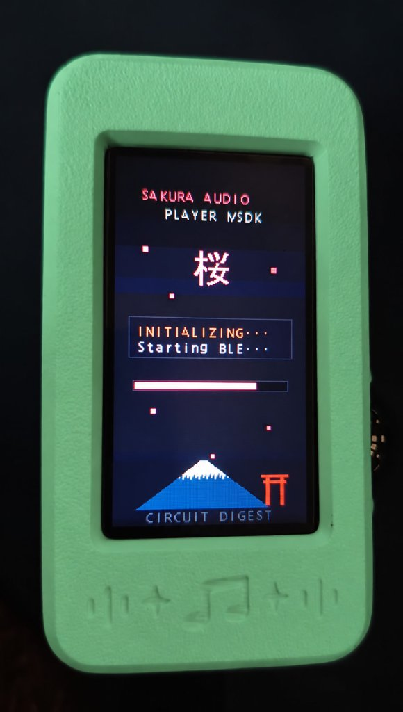
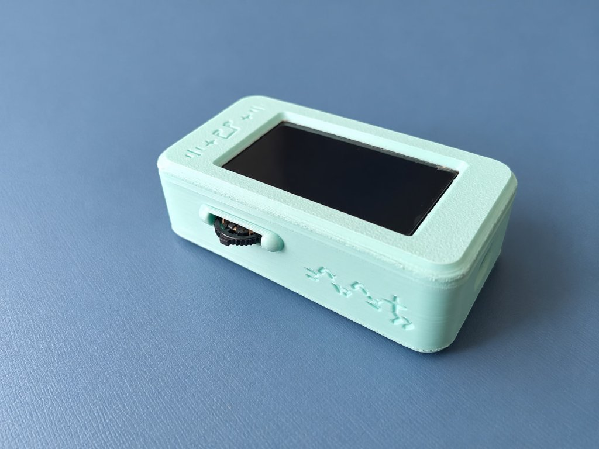
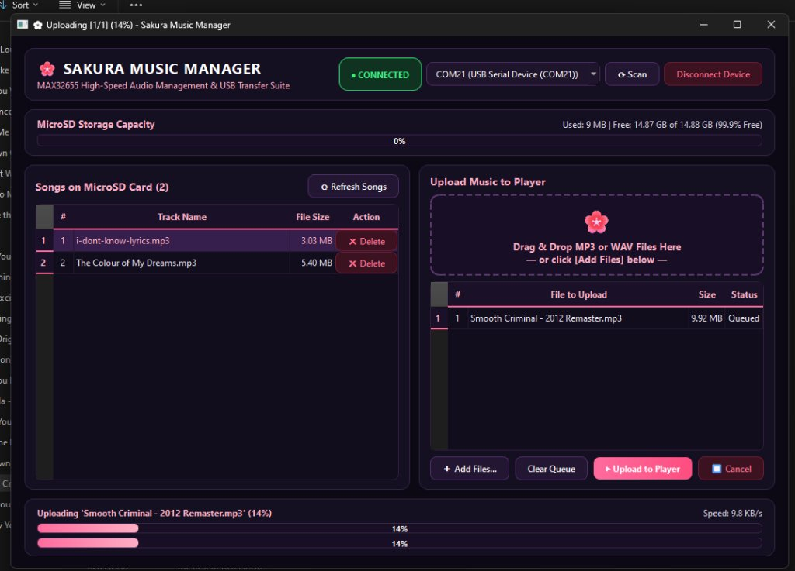

# Sakura Audio Player

Sakura Audio Player is a custom handheld MP3 player built around the Analog Devices MAX32655 microcontroller (ARM Cortex-M4 @ 100MHz) and a dedicated MAX9867 low-power stereo audio codec.

It combines real-time software MP3 decoding with hardware I2S audio output, a 1.9-inch IPS display, a side-mounted jog dial, animated pixel-art screensavers, and a desktop companion app for managing songs on the MicroSD card.

---

## Overview

The player was developed to test real-time audio decoding and UI responsiveness on resource-constrained microcontrollers. Audio decoding is handled entirely in software using `minimp3`, feeding stereo 16-bit 48kHz audio over I2S to the MAX9867 codec via DMA. The UI runs on an ST7789 display controller without blocking or causing playback interruptions.

### Main Specifications

- **Microcontroller:** Analog Devices MAX32655 (ARM Cortex-M4 with FPU, 100MHz, 512KB Flash, 128KB SRAM)
- **Audio Codec:** MAX9867 low-power stereo codec with headphone amplifier
- **Audio Output:** 16-bit stereo @ 48kHz via I2S + DMA
- **Audio Formats:** MP3 and WAV
- **Display:** 1.9" IPS LCD (ST7789V2 controller, 170x320 portrait resolution) over SPI
- **Storage:** MicroSD card (FAT32 filesystem, SPI mode)
- **Input:** 3-way navigation jog switch (Up, Down, Center-press) plus front tactile buttons
- **Power Management:** MAX20303 PMIC, battery fuel gauge, deep sleep (<15 uA) with instant GPIO wake
- **Battery:** Single-cell 3.7V LiPo

---

## Photos & Hardware

### Assembled Device

| Front View (Boot Splash) | Side View (Jog Switch & Profile) |
| :---: | :---: |
|  |  |

The enclosure is 3D printed with a side cut-out for the 3-way navigation switch and headphone jack.

### UI & Screensavers

When idle, the player can either turn off the display or transition to one of three animated pixel-art screensavers:

| Sakura Anime Girl | Sakura Bonsai Tree | Halloween Witch |
| :---: | :---: | :---: |
|  |  |  |

The player also supports two color themes:
- **Sakura Theme:** Soft pink and obsidian purple palette.
- **Halloween Theme:** Amber-orange and black palette with custom spooky accents.

---

## Flashing the Firmware

If you just want to run the firmware without setting up the full build environment, you can flash the pre-compiled binary directly.

### Pre-requisites

- An installed copy of OpenOCD (comes with the Maxim SDK or Zephyr SDK).
- Python 3.8+ with `pyserial` installed (`pip install pyserial`).

### Flashing Steps

1. Download [`max32655.bin`](https://github.com/Sparkshiva007/Sakura-Audio-Player/releases/download/v1.0.0/max32655.bin) and [`scratch_flasher.bin`](https://github.com/Sparkshiva007/Sakura-Audio-Player/releases/download/v1.0.0/scratch_flasher.bin) from the [v1.0.0 Release](https://github.com/Sparkshiva007/Sakura-Audio-Player/releases/tag/v1.0.0) page, or clone this repository.
2. Connect the MAX32655 board to your PC using the USB-C port.
3. On Windows, double-click:
   ```
   tools/flash_firmware.bat
   ```
   Or run the Python flasher from the command line:
   ```bash
   python tools/flash_firmware.py
   ```

The script automatically locates OpenOCD, connects over CMSIS-DAP, mass-erases internal flash, loads the fast RAM flasher, writes all 346 KB in approximately 12 seconds, and resets the board into the Sakura boot screen.

---

## Building from Source

To compile the firmware from scratch, you will need the Analog Devices Maxim SDK (MSDK).

### 1. Requirements

- **Analog Devices MSDK:** Download from the [Analog Devices MSDK User Guide](https://analogdevicesinc.github.io/msdk/USERGUIDE/). Default location: `C:/MaximSDK`.
- **Compiler:** `arm-zephyr-eabi-gcc` or `arm-none-eabi-gcc` (provided by the MSDK installer).
- **GNU Make:** Included in the MSDK tools folder.

### 2. Compile

Open a terminal in the `firmware/` folder and run:

```bash
make -j4 TARGET=MAX32655 BOARD=FTHR_Apps_P1 MAXIM_PATH=C:/MaximSDK PREFIX=arm-zephyr-eabi
```

The build output will be located at `firmware/build/max32655.bin` (approx. 346 KB).

### 3. Flash via OpenOCD

You can program the newly built binary using standard OpenOCD:

```bash
openocd -f interface/cmsis-dap.cfg -f target/max32655.cfg -c "init; reset halt; max32xxx mass_erase 0; program build/max32655.bin 0x10000000 verify reset exit"
```

Or run `python ../tools/flash_firmware.py` which will automatically pick up the new build.

---

## Music Management (Sakura Music Manager)

A desktop companion tool is provided in `tools/sakura_manager.py` (and as a standalone Windows executable `Sakura_Music_Manager.exe` in the releases).

<p align="center">
  
</p>

The app provides two modes for managing audio files:

### 1. Direct MicroSD Mode (Recommended)
- Insert the MicroSD card into your PC's card reader or USB adapter.
- The manager auto-detects the drive letter, reads storage capacity, and lists existing songs.
- Drag and drop MP3 or WAV files into the queue and click **Transfer to MicroSD**.
- Files write directly at normal card write speeds (30 to 80 MB/s), copying each song in a fraction of a second.

### 2. USB Cable Mode
- If you prefer not to remove the SD card, connect the player via USB cable.
- On the player, long-press the center button and select **USB Upload Mode**. The display shows the USB trident icon.
- In the PC app, switch to **USB Cable Mode**, select the COM port (`COM21`), and connect.
- Songs are transferred over the serial interface using CRC16 verification in 4KB/16KB chunks.

---

## Hardware Pinout & Wiring

| Peripheral | Signal | MAX32655 Pin | Description |
| :--- | :--- | :--- | :--- |
| **ST7789 Display** | SCK | P0.21 | SPI1 Clock (30 MHz) |
| | MOSI / SDA | P0.22 | SPI1 Data |
| | CS | P0.20 | Active-low Chip Select |
| | DC | P1.8 | Data / Command select |
| | RST | P1.9 | Hardware Reset |
| **MicroSD Slot** | SCK | P0.7 | SPI0 Clock (25 MHz) |
| | MOSI | P0.5 | SPI0 Master Out |
| | MISO | P0.6 | SPI0 Master In |
| | CS | P0.4 | Active-low Chip Select |
| | DET | P0.12 | Card Detect (active-low) |
| | PWR | P0.15 | Power enable |
| **MAX9867 Codec** | SCL | P0.16 | I2C1 Clock (Address: 0x18) |
| | SDA | P0.17 | I2C1 Data |
| | BCLK | P0.26 | I2S0 Bit Clock |
| | LRCLK | P0.27 | I2S0 Word Select |
| | SDOUT | P0.25 | I2S0 Serial Audio Data |
| **Jog Switch** | UP | P2.2 | Previous track / cursor up (internal pull-up) |
| | SELECT | P2.1 | Select / toggle play-pause (internal pull-up) |
| | DOWN | P2.0 | Next track / cursor down (internal pull-up) |
| **Buttons** | SW2 | P0.2 | Previous / backward button |
| | SW3 | P0.3 | Next / forward button |
| | SW4 | P3.0 | Play / Pause / Power button |
| **PMIC** | MAX20303 | Internal I2C0 | Power rail control, battery charging & monitoring |

For complete circuit details, see [hardware/PINOUT.md](hardware/PINOUT.md) and [hardware/BOM.md](hardware/BOM.md).

---

## Controls & Usage

- **Track Navigation:** Flick the jog dial Up or Down to scroll through songs.
- **Play / Pause:** Press the jog dial Center (or front center button).
- **Settings Menu:** Long-press the center button to open the settings menu:
  - **Screensaver:** Choose between Sakura Girl, Bonsai Tree, or Halloween Witch.
  - **Inactivity Timer:** 5s, 10s, 30s, or 1 minute before entering sleep/screensaver.
  - **Theme:** Switch between Sakura and Halloween palettes.
  - **USB Upload:** Enter USB transfer mode.
  - **Power Off:** Enter low-power shutdown. Wake up anytime by pressing the center button.

---

## Project Structure

```
Sakura-Audio-Player/
├── assets/                  # Photos, screensaver art, and screenshots
├── bin/                     # Pre-built max32655.bin and scratch_flasher.bin
├── firmware/                # C source code and Makefiles
│   ├── main.c               # Board init and main scheduler
│   ├── player_app.c         # UI state machine and event handling
│   ├── display.c            # ST7789 display driver and render loops
│   ├── audio_player.c       # minimp3 decoder and I2S DMA pipeline
│   ├── max9867.c            # MAX9867 codec I2C configuration
│   ├── sd_spi.c             # SPI driver for MicroSD / FatFS
│   ├── *_art.h              # Pixel art bitmap arrays
│   └── Makefile             # MSDK build rules
├── hardware/                # Hardware pinout table and Bill of Materials
├── tools/                   # Flasher scripts and PC manager source
├── LICENSE                  # MIT License
└── README.md
```

---

## License & Credits

- **Author:** Shivashankar P ([@Sparkshiva007](https://github.com/Sparkshiva007))
- **License:** [MIT License](LICENSE)
- **Third-Party Libraries:**
  - `minimp3` by Lieff (public domain / CC0) for embedded MP3 decoding.
  - Analog Devices MSDK for peripheral drivers and board support packages.
  - Circuit Digest for initial evaluation reference.
